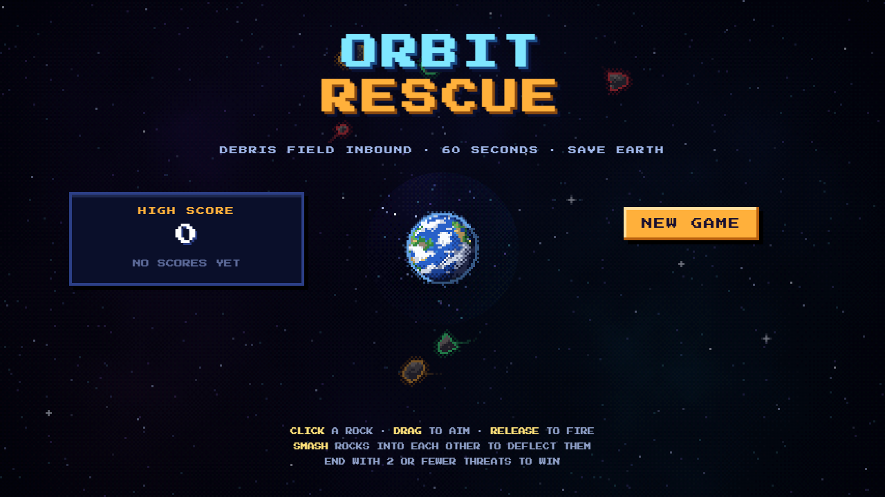

# Orbit Rescue

A single-file, no-build pixel-art orbital rescue game. Nudge meteors away from Earth, or smash them into each other for deflects.

**Play it now:** https://orbit-rescue.vercel.app  
**Source:** https://github.com/jeswintom22/Orbit-Rescue



## How to play

1. **Click** a rock to lock your satellite onto it.
2. **Drag** to aim and set thrust strength.
3. **Release** to fire a one-time nudge.

While you aim, time slows down and a dotted prediction line shows where the rock will go. Hit other rocks to deflect threats away from Earth.

## Controls

| Action | Mouse / Touch |
|--------|---------------|
| Lock on rock | Click a meteor |
| Aim nudge | Drag from the rock |
| Fire | Release |
| Start / restart | Enter or on-screen buttons |

## Win & lose

- **Win:** Earth survives 60 seconds with 2 or fewer threats remaining.
- **Lose:** Earth's hull reaches 0, or more than 2 threats remain when time runs out.

## Scoring

```
Score = saved rocks × remaining hull × remaining fuel bonus
```

The best run is saved locally. Bonus points for rock-on-rock deflects.

## Features

- Simplified inverse-square orbital physics
- Pixel-art framebuffer rendering (3× scale, dithered sprites)
- Earth with day/night cycle, city lights, atmosphere, and impact craters
- Rock-on-rock collisions with aim preview
- Slow-motion aiming
- Wave progression every 15 seconds
- Web Audio sound effects and ambient drone
- Local high-score table
- Loading / menu page

## Tech

- Plain HTML5 Canvas 2D + JavaScript
- `requestAnimationFrame` game loop
- Fixed-step physics at 120 Hz
- No libraries, no build step
- `localStorage` for high scores

## Run locally

Just open `index.html` in any modern browser. No server required.

```bash
# Or serve it from any static server:
npx serve .
```

## Deployment

The project is connected to Vercel and auto-deploys on every push to `main`.

```bash
git push origin main
```

---

Built with Devin.
